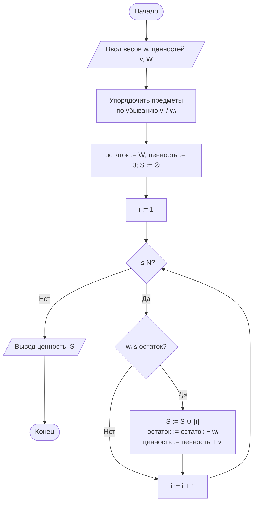

# Лабораторная работа № 8

## Жадные алгоритмы и экспериментальная оценка качества приближённых решений

**Дисциплина:** Теория алгоритмов
**Направление подготовки:** 38.03.05 «Бизнес-информатика»
**Курс:** 2
**Объём:** 4 академических часа
**Язык реализации:** Python 3.10+
**Предварительные требования:** ЛР № 7 (динамическое программирование)

---

## 1. Цель и задачи работы

**Цель работы:** изучить жадную стратегию построения алгоритмов, установить условия, при которых она приводит к оптимальному решению, и экспериментально оценить отклонение жадного решения от оптимального в задачах, где эти условия не выполняются.

**Задачи:**

1. Изучить понятия жадного выбора, оптимальной подструктуры и приближённого решения.
2. Реализовать жадные алгоритмы с различными критериями выбора.
3. Реализовать точное решение той же задачи (динамическое программирование или полный перебор) как эталон.
4. Измерить отклонение жадного решения от оптимума на серии случайных наборов данных.
5. Построить контрпример, на котором жадный алгоритм даёт неоптимальный результат, и объяснить его причину.

---

## 2. Теоретическая часть

### 2.1. Жадная стратегия

**Жадный алгоритм** на каждом шаге делает выбор, который выглядит наилучшим в данный момент, и никогда не пересматривает принятые решения. В отличие от динамического программирования, он не рассматривает все варианты, а следует единственной траектории.

Общая схема:

1. упорядочить элементы по некоторому критерию;
2. последовательно просматривать их и включать в решение, если это допустимо;
3. остановиться, когда элементы исчерпаны или ограничение достигнуто.

Трудоёмкость обычно определяется сортировкой, то есть $\Theta(n \log n)$.

### 2.2. Условия оптимальности

Жадный алгоритм даёт **точный** оптимум, если задача обладает двумя свойствами [1]:

1. **Свойство жадного выбора.** Существует оптимальное решение, содержащее выбор, сделанный жадно на первом шаге.
2. **Оптимальная подструктура.** После первого выбора остаётся подзадача того же вида, и оптимум исходной задачи складывается из сделанного выбора и оптимума подзадачи.

Формальное обобщение этих условий даёт **теория матроидов**: если система допустимых множеств образует матроид, жадный алгоритм с сортировкой по весу оптимален. В рамках данного курса достаточно понимать саму идею: оптимальность жадности — не правило, а свойство конкретной задачи, которое требует доказательства.

### 2.3. Задачи, где жадность оптимальна

| Задача | Жадный критерий | Результат |
|---|---|---|
| Выбор максимального числа непересекающихся заявок | Наиболее ранний момент окончания | Оптимум |
| Непрерывный (дробный) рюкзак | Максимальная удельная ценность $v_i / w_i$ | Оптимум |
| Кодирование Хаффмана | Слияние двух наименьших частот | Оптимум |
| Минимальное остовное дерево (алгоритмы Прима и Краскала) | Наименьшее ребро | Оптимум |

В **дробном** рюкзаке предмет можно разделить. Поэтому рюкзак всегда заполняется полностью, и достаточно брать наиболее «ценные за килограмм» предметы. Именно делимость делает жадность оптимальной.

### 2.4. Задачи, где жадность не оптимальна

**Задача о рюкзаке 0/1.** Предметы неделимы, и жадный выбор по удельной ценности может оставить незаполненный остаток. Классический контрпример: $W = 10$ и предметы

| Предмет | Вес | Ценность | Удельная ценность |
|---|---|---|---|
| 1 | 6 | 12 | 2,0 |
| 2 | 5 | 9 | 1,8 |
| 3 | 5 | 9 | 1,8 |

Жадный алгоритм берёт предмет 1 (ценность 12), после чего остаётся вместимость 4, и ничего больше не помещается. Оптимум — предметы 2 и 3 с суммарной ценностью 18. Отклонение составляет 33 %.

**Задача о размене суммы.** Для «канонических» систем номиналов (1, 5, 10, 25 или 1, 2, 5, 10) жадный алгоритм оптимален. Для произвольных систем — нет. Пример: номиналы 1, 3, 4 и сумма $S = 6$. Жадный алгоритм даёт $4 + 1 + 1$ (три монеты), оптимум — $3 + 3$ (две монеты).

Важно, что здесь **не существует** простого критерия оптимальности жадности: проверять свойство приходится для каждой системы номиналов отдельно.

### 2.5. Оценка качества приближённого решения

Если точный алгоритм слишком дорог, жадный используется как **приближённый**. Качество оценивают отношением

$$\rho = \frac{V_{\text{жадн}}}{V_{\text{опт}}} \le 1 \qquad \text{(для задач максимизации)},$$

или относительным отклонением $\delta = (1 - \rho) \cdot 100\%$.

Исследуются:

- **среднее** отклонение на случайных наборах данных;
- **максимальное** наблюдаемое отклонение;
- **доля** наборов, на которых жадность достигла оптимума.

Для многих задач доказаны гарантированные оценки. Например, для рюкзака 0/1 модификация «лучшее из жадного решения и самого ценного одиночного предмета» гарантирует $\rho \ge 1/2$. Такие алгоритмы называются алгоритмами с гарантированной оценкой точности.

### 2.6. Сопоставление стратегий

| Свойство | Жадный алгоритм | Динамическое программирование | Полный перебор |
|---|---|---|---|
| Трудоёмкость (рюкзак) | $\Theta(n \log n)$ | $\Theta(nW)$ | $\Theta(2^n)$ |
| Память | $O(n)$ | $\Theta(nW)$ или $\Theta(W)$ | $O(n)$ |
| Результат | Приближённый | Точный | Точный |
| Применимость | Большие размерности | Умеренные $W$ | Только малые $n$ |

---

## 3. Порядок выполнения работы

1. Изучить теоретическую часть.
2. Реализовать жадный алгоритм задачи своего варианта (табл. 1) с критерием выбора, указанным в варианте.
3. Реализовать **второй** жадный критерий и сравнить его с первым.
4. Реализовать точный алгоритм (ДП или перебор) как эталон.
5. Сгенерировать серию из не менее чем 200 случайных наборов данных, для каждого вычислить решения обоими способами.
6. Вычислить среднее и максимальное отклонение жадного решения от оптимума, а также долю наборов с точным совпадением.
7. Построить **контрпример вручную** и показать на нём ошибку жадного алгоритма.
8. Сравнить время работы жадного и точного алгоритмов при росте размерности.
9. Оформить отчёт.

---

## 4. Варианты заданий

**Таблица 1. Исходные данные**

| № | Задача | Жадный критерий 1 | Жадный критерий 2 | Размерность | Доп. |
|---|---|---|---|---|---|
| 0 | Рюкзак 0/1 | Удельная ценность | Максимальная ценность | $N = 20$, $W = 100$ | — |
| 1 | Размен суммы | Наибольший номинал | Случайный допустимый | Номиналы 1, 3, 4; $S \le 100$ | Ж1 |
| 2 | Рюкзак 0/1 | Минимальный вес | Удельная ценность | $N = 22$, $W = 120$ | Ж2 |
| 3 | Выбор заявок | Раннее окончание | Раннее начало | 30 заявок | Ж3 |
| 4 | Размен суммы | Наибольший номинал | Наименьший номинал | Номиналы 1, 6, 9; $S \le 150$ | Ж4 |
| 5 | Рюкзак 0/1 | Удельная ценность | Минимальный вес | $N = 25$, $W = 150$ | Ж5 |
| 6 | Загрузка контейнеров (bin packing) | Первый подходящий | Наилучший подходящий | 100 предметов | Ж6 |
| 7 | Выбор заявок | Минимальная длительность | Раннее окончание | 40 заявок | Ж7 |
| 8 | Рюкзак 0/1 | Максимальная ценность | Удельная ценность | $N = 20$, $W = 80$ | Ж1 |
| 9 | Размен суммы | Наибольший номинал | Наибольший, затем корректировка | Номиналы 1, 7, 10; $S \le 200$ | Ж2 |
| 10 | Планирование работ со штрафами | Наибольший штраф | Наименьший срок | 20 работ | Ж3 |
| 11 | Рюкзак 0/1 | Удельная ценность | Максимальная ценность | $N = 24$, $W = 200$ | Ж4 |
| 12 | Загрузка контейнеров | Наихудший подходящий | Наилучший подходящий | 150 предметов | Ж5 |
| 13 | Размен суммы | Наибольший номинал | Наименьший номинал | Номиналы 1, 5, 11; $S \le 120$ | Ж6 |
| 14 | Выбор заявок | Раннее окончание | Максимальная ценность заявки | 35 заявок | Ж7 |
| 15 | Рюкзак 0/1 | Минимальный вес | Максимальная ценность | $N = 21$, $W = 100$ | Ж1 |
| 16 | Размен суммы | Наибольший номинал | Случайный допустимый | Номиналы 1, 4, 9; $S \le 160$ | Ж2 |
| 17 | Планирование работ со штрафами | Наибольший штраф | Наибольшее отношение штраф/время | 25 работ | Ж3 |
| 18 | Рюкзак 0/1 | Удельная ценность | Случайный порядок | $N = 22$, $W = 90$ | Ж4 |
| 19 | Загрузка контейнеров | Первый подходящий (с сортировкой по убыванию) | Без сортировки | 120 предметов | Ж5 |
| 20 | Выбор заявок | Раннее окончание | Позднее начало | 30 заявок | Ж6 |
| 21 | Размен суммы | Наибольший номинал | Наибольший из двух старших | Номиналы 1, 8, 12; $S \le 180$ | Ж7 |
| 22 | Рюкзак 0/1 | Максимальная ценность | Минимальный вес | $N = 23$, $W = 140$ | Ж1 |
| 23 | Планирование работ | Наименьшая длительность | Наибольшая прибыль | 20 работ | Ж2 |
| 24 | Размен суммы | Наибольший номинал | Наименьший номинал | Номиналы 1, 3, 7; $S \le 140$ | Ж3 |
| 25 | Рюкзак 0/1 | Удельная ценность | Максимальная ценность | $N = 26$, $W = 110$ | Ж4 |
| 26 | Загрузка контейнеров | Наилучший подходящий | Первый подходящий | 200 предметов | Ж5 |
| 27 | Выбор заявок | Раннее окончание | Минимальное число пересечений | 45 заявок | Ж6 |
| 28 | Размен суммы | Наибольший номинал | Случайный допустимый | Номиналы 1, 2, 9, 13; $S \le 170$ | Ж7 |
| 29 | Рюкзак 0/1 | Удельная ценность | Минимальный вес | $N = 20$, $W = 160$ | Ж1 |
| 30 | Рюкзак 0/1 и размен | Удельная ценность; наибольший номинал | Максимальная ценность; наименьший номинал | $N = 20$, $W = 100$; номиналы 1, 3, 4 | Ж3 |

**Таблица 2. Дополнительные задания**

| Код | Содержание |
|---|---|
| Ж1 | Реализовать **дробный** вариант рюкзака и доказать экспериментально, что там жадность совпадает с оптимумом на всех наборах. Объяснить, почему неделимость всё меняет |
| Ж2 | Построить гистограмму отклонений жадного решения от оптимума по 500 наборам данных. Указать среднее, медиану и максимум |
| Ж3 | Доказать (или опровергнуть) оптимальность жадного критерия варианта строгим рассуждением; при опровержении предъявить минимальный контрпример |
| Ж4 | Исследовать зависимость отклонения от размерности задачи: построить график среднего отклонения при $N = 5, 10, 20, 40, 80$ |
| Ж5 | Сравнить время работы жадного и точного алгоритмов при росте $N$. Определить $N$, при котором точный метод становится неприменим за 10 с |
| Ж6 | Реализовать **улучшенную** жадную схему: лучшее из результатов двух критериев, либо локальное улучшение (попытка замены одного предмета). Оценить прирост качества |
| Ж7 | Сформулировать прикладную задачу (распределение бюджета между инициативами) и сопоставить рекомендации жадного и точного алгоритмов. Оценить цену ошибки в денежном выражении |

---

## 5. Требования к отчёту

1. Титульный лист.
2. Цель работы и задание варианта.
3. Описание задачи, обоих жадных критериев и точного алгоритма.
4. Блок-схема жадного алгоритма.
5. Листинг программы.
6. Таблица результатов по серии наборов данных: среднее и максимальное отклонение, доля совпадений с оптимумом.
7. Разобранный вручную контрпример с расчётами.
8. Сравнение времени работы алгоритмов.
9. Выводы с рекомендацией о применимости жадной стратегии.

---

## 6. Пример оформления отчёта (вариант 0)

### 6.1. Задание

Для задачи о рюкзаке 0/1 при $N = 20$, $W = 100$ реализовать два жадных критерия (по удельной ценности и по максимальной ценности) и точное решение методом ДП. На 500 случайных наборах оценить отклонение от оптимума. Построить контрпример.

### 6.2. Блок-схема жадного алгоритма



### 6.3. Листинг программы

```python
"""
Лабораторная работа № 8. Вариант 0.
Задача о рюкзаке 0/1: два жадных критерия против точного решения (ДП).
"""
import random
import statistics
import time


def knapsack_dp(weights, values, capacity):
    """Точное решение. Возвращает максимальную ценность."""
    D = [0] * (capacity + 1)
    for wi, vi in zip(weights, values):
        for w in range(capacity, wi - 1, -1):      # обратный порядок: предмет один раз
            if D[w - wi] + vi > D[w]:
                D[w] = D[w - wi] + vi
    return D[capacity]


def knapsack_greedy(weights, values, capacity, key):
    """Жадный алгоритм. key задаёт критерий упорядочивания предметов."""
    order = sorted(range(len(weights)), key=key, reverse=True)
    total, remain, chosen = 0, capacity, []
    for i in order:
        if weights[i] <= remain:
            chosen.append(i)
            remain -= weights[i]
            total += values[i]
    return total, sorted(chosen)


def greedy_density(weights, values, capacity):
    """Критерий 1: максимальная удельная ценность vᵢ / wᵢ."""
    return knapsack_greedy(weights, values, capacity,
                           key=lambda i: values[i] / weights[i])


def greedy_value(weights, values, capacity):
    """Критерий 2: максимальная ценность vᵢ."""
    return knapsack_greedy(weights, values, capacity, key=lambda i: values[i])


def experiment(trials=500, n=20, capacity=100, seed=2024):
    """Серия случайных наборов: отклонение жадных решений от оптимума."""
    rng = random.Random(seed)
    dev = {"Удельная ценность": [], "Максимальная ценность": []}
    exact_hits = {k: 0 for k in dev}
    for _ in range(trials):
        weights = [rng.randint(5, 40) for _ in range(n)]
        values = [rng.randint(10, 100) for _ in range(n)]
        opt = knapsack_dp(weights, values, capacity)
        for name, func in [("Удельная ценность", greedy_density),
                           ("Максимальная ценность", greedy_value)]:
            got, _ = func(weights, values, capacity)
            dev[name].append((opt - got) / opt * 100)
            if got == opt:
                exact_hits[name] += 1
    return dev, exact_hits, trials


if __name__ == "__main__":
    # --- Контрпример ---
    w, v, W = [6, 5, 5], [12, 9, 9], 10
    g, chosen = greedy_density(w, v, W)
    opt = knapsack_dp(w, v, W)
    print("Контрпример: веса", w, "ценности", v, "W =", W)
    print(f"  Жадно (по удельной ценности): предметы {chosen}, ценность {g}")
    print(f"  Оптимум (ДП): ценность {opt}, отклонение {(opt - g) / opt * 100:.1f} %\n")

    # --- Серия экспериментов ---
    dev, hits, trials = experiment()
    print(f"Серия из {trials} случайных наборов (N = 20, W = 100):")
    print(f"{'Критерий':<24}{'среднее, %':>12}{'медиана, %':>12}"
          f"{'максимум, %':>13}{'совпало с оптимумом':>22}")
    for name, d in dev.items():
        print(f"{name:<24}{statistics.mean(d):>12.2f}{statistics.median(d):>12.2f}"
              f"{max(d):>13.2f}{hits[name] / trials * 100:>21.1f}%")

    # --- Сравнение времени при росте N ---
    print(f"\n{'N':>6}{'жадный, с':>14}{'ДП, с':>12}{'отношение':>12}")
    rng = random.Random(1)
    for n in [100, 500, 2000, 5000]:
        weights = [rng.randint(5, 40) for _ in range(n)]
        values = [rng.randint(10, 100) for _ in range(n)]
        cap = 1000
        t0 = time.perf_counter(); greedy_density(weights, values, cap)
        t_g = time.perf_counter() - t0
        t0 = time.perf_counter(); knapsack_dp(weights, values, cap)
        t_dp = time.perf_counter() - t0
        print(f"{n:>6}{t_g:>14.4f}{t_dp:>12.4f}{t_dp / t_g:>12.1f}")
```

### 6.4. Результаты

Измерения выполнены в среде Linux, Python 3.12.

**Контрпример.** Веса $(6, 5, 5)$, ценности $(12, 9, 9)$, $W = 10$. Жадный алгоритм по удельной ценности берёт только первый предмет и даёт ценность 12; оптимум равен 18. Отклонение составляет 33,3 %.

**Таблица 3. Отклонение жадных решений от оптимума (500 наборов, $N = 20$, $W = 100$)**

| Критерий | Среднее отклонение, % | Медиана, % | Максимум, % | Доля точных совпадений |
|---|---|---|---|---|
| Удельная ценность $v_i / w_i$ | 1,42 | 0,00 | 14,19 | 50,6 % |
| Максимальная ценность $v_i$ | 15,37 | 13,54 | 51,68 | 7,0 % |

Медиана отклонения для первого критерия равна нулю: более чем в половине наборов жадное решение совпало с оптимальным. Однако максимальное отклонение достигает 14 %, то есть гарантий качества жадный алгоритм не даёт.

**Таблица 4. Время работы при $W = 1000$**

| $N$ | Жадный, с | ДП, с | Отношение |
|---|---|---|---|
| 100 | 0,0001 | 0,0067 | 119 |
| 500 | 0,0001 | 0,0271 | 248 |
| 2000 | 0,0005 | 0,0978 | 205 |
| 5000 | 0,0013 | 0,2581 | 203 |

### 6.5. Выводы (образец)

1. Жадный алгоритм по удельной ценности даёт решения, близкие к оптимальным: среднее отклонение 1,4 %, а в 50,6 % наборов достигнут точный оптимум. Критерий «максимальная ценность» заметно хуже: он игнорирует вес и потому расходует вместимость неэффективно.
2. Контрпример показывает механизм ошибки: жадный выбор самого «выгодного за килограмм» предмета оставляет незаполненный остаток вместимости, который уже невозможно использовать. Отклонение достигает 33 % при трёх предметах.
3. Критерий «максимальная ценность» даёт среднее отклонение 15,4 % и совпадает с оптимумом лишь в 7 % случаев. Это показывает, что качество жадного алгоритма определяется не самой стратегией, а выбранным критерием упорядочивания.
4. По времени жадный алгоритм существенно превосходит ДП, причём разрыв растёт с $N$: $\Theta(n \log n)$ против $\Theta(nW)$. При больших $W$ точный метод становится неприменим, и приближённое решение оказывается единственно возможным.
5. Практический вывод для аналитика: жадное правило («сначала самые рентабельные проекты») даёт хорошее, но не обязательно оптимальное распределение бюджета. Величину потерь следует оценивать, а не постулировать.

---

## 7. Контрольные вопросы

1. Опишите общую схему жадного алгоритма. Чем он отличается от динамического программирования?
2. Сформулируйте свойство жадного выбора и свойство оптимальной подструктуры.
3. Почему в дробном рюкзаке жадность оптимальна, а в задаче 0/1 — нет?
4. Приведите контрпример к жадному размену для системы номиналов 1, 3, 4.
5. Для каких систем номиналов жадный размен оптимален? Как это проверить?
6. Что такое коэффициент качества приближённого решения $\rho$?
7. Почему жадный алгоритм для задачи о выборе заявок оптимален? Какой критерий используется?
8. Как оценить, оправдано ли применение приближённого алгоритма в конкретной задаче?
9. Сравните трудоёмкость жадного алгоритма, ДП и полного перебора для рюкзака.
10. Приведите пример управленческого решения, которое принимается по жадному правилу. Каковы риски такого подхода?

---

## 8. Рекомендуемая литература

1. Кормен Т., Лейзерсон Ч., Ривест Р., Штайн К. Алгоритмы: построение и анализ. — 3-е изд. — М.: Вильямс, 2013. — Гл. 16.
2. Рафгарден Т. Совершенный алгоритм. Жадные алгоритмы и динамическое программирование. — СПб.: Питер, 2020.
3. Скиена С. Алгоритмы. Руководство по разработке. — 3-е изд. — СПб.: БХВ-Петербург, 2022.
4. Левитин А. Алгоритмы. Введение в разработку и анализ. — М.: Вильямс, 2006. — Гл. 9.
5. Пападимитриу Х., Стайглиц К. Комбинаторная оптимизация. Алгоритмы и сложность. — М.: Мир, 1985.
6. Бхаргава А. Грокаем алгоритмы. — 2-е изд. — СПб.: Питер, 2024. — Гл. 8.
